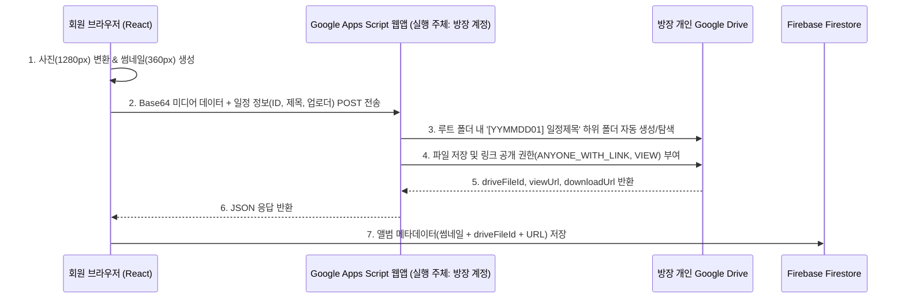

# Album and Media Compression Specification

## Overview
Healing78 커뮤니티의 일정별 추억 사진·동영상을 공유하고 모아볼 수 있는 **앨범(Album)** 기능의 미디어 일반화질 자동 변환 규격, **개인 구글 드라이브(Google Drive) 자동 저장 브릿지 아키텍처**, UI 배치 구조, 그리고 확장형 열람/업로드 권한 체계를 정의합니다.

## Business Rules & Logic

### 1. Client-Side Media Compression & Standard Quality Rules
- **사진(Image) 일반화질 자동 변환 규격:**
  - **최대 해상도:** 가로/세로 중 긴 변 기준 최대 **`1280px`** (원본 비율 유지, `1280px` 이하인 경우 리사이징 생략)
  - **압축 포맷 및 품질:** `HTML5 Canvas` 기반 `image/jpeg` (또는 `image/webp`), 품질 계수 **`0.78`**
  - **목록용 썸네일:** 그리드 렌더링 성능 및 즉시 표시(Smart Caching)를 위해 **`360 × 360px`** (품질 `0.65`) 정사각형 썸네일 프리뷰 병행 생성
  - **목표 용량:** 일반화질 본본 약 **`120KB ~ 220KB`**, 썸네일 약 **`15KB ~ 30KB`** 수준으로 원본 대비 90~95% 용량 절감
- **동영상(Video) 일반화질 규격 및 썸네일 추출:**
  - **권장 해상도 및 제한:** **`720p (1280 × 720)`** 이하 권장, 길이 최대 **`30초`**, 파일당 최대 **`15MB`** 제한
  - **자동 커버 프레임 추출:** 업로드 시 `<video>` 엘리먼트의 **`1.0초`** 지점 프레임을 캡처하여 `360px` 정지 썸네일 이미지를 자동 생성하고, 목록에서는 정지 썸네일 + `▶ 재생시간` 배지만 렌더링한 뒤 클릭 시 영상을 로드합니다.

### 2. Personal Google Drive Storage Architecture (GAS Bridge + Hybrid Caching)
카카오 로그인을 사용하는 일반 회원들이 별도의 구글 로그인 없이도 방장(운영자)의 개인 구글 드라이브에 사진·동영상을 자동 저장할 수 있도록 **Google Apps Script(GAS) 웹앱 브릿지**와 **Firestore 스마트 캐싱**을 결합한 하이브리드 구조를 사용합니다.



- **폴더 자동 분류 규칙:**
  - 지정된 구글 드라이브 루트 폴더(`ROOT_FOLDER_ID`) 아래에 일정별로 **`[26110701] 11월 서울 강남 정기 모임`** 형태의 하위 폴더가 자동 생성됩니다.
  - 저장 파일명은 **`26110701_김민준_1730700000.jpg`** 형태로 누가 언제 올린 파일인지 구글 드라이브에서도 즉시 식별할 수 있도록 명명합니다.
- **하이브리드 열람 및 폴백(Fallback) 전략:**
  - **목록 그리드:** Firestore에 캐싱된 경량 `thumbUrl`을 사용하여 구글 드라이브 트래픽 제한이나 초기 로딩 지연 없이 즉시 렌더링합니다.
  - **상세 뷰어 & 동영상 재생 & 원본 다운로드:** 구글 드라이브의 `driveFileId` 기반 스트리밍/다운로드 URL을 연결하여 재생 및 파일 저장을 지원합니다.
  - **안전 폴백:** 만약 구글 드라이브 브릿지 URL이 아직 설정되지 않았거나 일시적 네트워크 오류가 발생해도, 압축된 일반화질 이미지가 앱 내 저장소(Firestore/LocalStorage)에 안전하게 저장되어 사진 유실을 방지합니다.
  - **운영진 웹 설정 연동:** `.env`(`VITE_GOOGLE_DRIVE_BRIDGE_URL`)뿐만 아니라 앱 내 **`운영 관리 > 공지·규칙 설정`** 화면에서도 구글 드라이브 브릿지 URL을 언제든 등록·변경할 수 있도록 지원합니다.

### 3. Album Navigation & Placement Structure
- **개별 일정 `벙대기실` 내부 4번째 탭 (`📸 앨범`):**
  - 기존 3개 탭(`장소·코스`, `정산·회비`, `귀가현황`) 우측에 4번째 **`앨범`** 탭을 배치합니다.
  - 해당 일정에서 촬영한 사진·동영상을 3열 정사각형 그리드로 표시하고, 클릭 시 전체화면 라이트박스(슬라이드 뷰어)로 감상할 수 있습니다.
- **하단 메인 탭바 & PC 사이드바 `앨범` 메뉴 (`/album`):**
  - 전체 일정들의 앨범을 월별·일정별로 모아보는 전용 메뉴를 제공합니다.

### 4. Access Control & "Random Box" (랜덤 박스) Unlock System

#### A. 기본 열람 및 업로드 권한 (Base Rule)
- **기본 허용 대상:** 해당 일정의 참석자(`applicants` / `confirmedParticipants`), 주최자(벙주), 총무, 그리고 운영진(`Leader`, `Deputy`).
- **미참석자 기본 상태:** 앨범 탭 접근 시 미디어 목록이 블러(Blur) 실루엣으로 처리되고, **"랜덤 박스"** 해제 화면이 제공됩니다.

#### B. 랜덤 박스 (Random Box) 시스템 개요
미참석 회원이라도 커뮤니티 활동도, 벙주와의 친분, 또는 벙주가 출제한 수수께끼를 해결하여 **랜덤 박스를 해제(Unlock)**하면 해당 일정 앨범의 열람 권한을 취득할 수 있는 게이미피케이션 권한 체계입니다.
- **해제 조건:** 벙주가 세팅한 후보 랜덤 박스들 중 **지정된 개수(기본 1개)**만 통과하면 즉시 해당 모임의 앨범이 영구 열람 가능 상태로 전환됩니다.
- **벙주의 자율 선택권:** 일정 등록 및 수정 시 `랜덤 박스 허용 여부(ON/OFF)`를 벙주가 직접 결정할 수 있어, 사생활 보호가 극히 민감한 소수 모임은 완전히 비공개(참석자 전용)로 유지할 수 있습니다.

#### C. 초기 확정 3대 퀘스트 랜덤 박스 조합
1. **[활동 조건형] 성실 힐러 박스 (`ACTIVITY_ATTENDANCE`)**
   - **판별 기준:** 커뮤니티 가입 기간 14일 이상 + 누적 벙 참석 횟수 10회 이상
   - **동작 방식:** 회원의 활동 프로필 데이터를 시스템이 자동 검증하여, 조건을 만족하는 우수 활동자는 클릭 한 번으로 즉시 잠금 해제.
2. **[관계·인연형] 벙주와의 인연 박스 (`HOST_RELATIONSHIP`)**
   - **판별 기준:** 현재 사용자와 해당 일정 벙주가 과거 완료된 모임에 **함께 참석한 누적 횟수 3회 이상**
   - **동작 방식:** 전체 모임 내역의 교집합을 자동 계산(`getMetCountWithHost`)하여, 벙주와 이미 여러 번 만난 친분이 입증되면 즉시 해제.
3. **[인터랙션형] 벙주 시크릿 퀴즈 박스 (`MEETING_QUIZ`)**
   - **판별 기준:** 벙주가 등록 시 입력한 수수께끼·질문(예: *"오늘 2차로 간 카페 이름은?"*, *"구워 먹은 고기 부위는?"*)의 정답 일치
   - **동작 방식:** 답안을 입력받아 정답과 비교(공백/대소문자 정규화) 후 정답 시 해제. 모임 후기나 단톡방 소통을 유도.

#### D. 향후 추가 개발을 고려한 확장형 아키텍처 (Quest Handler Registry)
새로운 종류의 랜덤 박스(예: 마니또 박스, 1일 1회 출석 럭키 박스, 가위바위보 미션 등)를 코어 로직 수정 없이 독립 모듈 형태로 즉시 플러그인할 수 있도록 **Registry 패턴**으로 설계합니다.

```javascript
// src/services/randomBoxRegistry.js (확장 아키텍처 규격)
export const RandomBoxQuestRegistry = {
  // 1. 성실 힐러 박스
  ACTIVITY_ATTENDANCE: {
    type: 'ACTIVITY_ATTENDANCE',
    name: '성실 힐러 박스',
    icon: '🏆',
    description: '가입 14일 이상 & 누적 벙 10회 이상 참석 시 해제',
    checkAutoEligible: (user, meeting, context) => {
      const daysSinceJoin = (Date.now() - new Date(user.joinedAt).getTime()) / (1000 * 60 * 60 * 24);
      return daysSinceJoin >= 14 && (user.attendanceCount || 0) >= 10;
    }
  },
  // 2. 벙주와의 인연 박스
  HOST_RELATIONSHIP: {
    type: 'HOST_RELATIONSHIP',
    name: '벙주와의 인연 박스',
    icon: '🤝',
    description: '벙주와 함께한 벙 3회 이상 시 해제',
    checkAutoEligible: (user, meeting, context) => {
      const metCount = context.getMetCountWithHost(user.uid, meeting.hostId);
      return metCount >= (meeting.randomBoxConfig?.minMetCount || 3);
    }
  },
  // 3. 벙주 시크릿 퀴즈 박스
  MEETING_QUIZ: {
    type: 'MEETING_QUIZ',
    name: '벙주 시크릿 퀴즈 박스',
    icon: '🧩',
    description: '벙주가 낸 수수께끼 정답을 맞추면 해제',
    requiresInput: true,
    verifyAnswer: (userAnswer, meeting) => {
      const target = (meeting.randomBoxConfig?.quizAnswer || '').trim().toLowerCase();
      const input = (userAnswer || '').trim().toLowerCase();
      return target && input === target;
    }
  }
  // [미래 확장 슬롯]: 여기에 새로운 퀘스트(예: LUCKY_DRAW, SECRET_CODE 등)를 핸들러 단위로 추가 등록
};
```

#### E. 권한 및 잠금 해제 데이터 모델
- **모임 문서 (`meeting.randomBoxConfig`):**
  - `enabled`: boolean (기본값 `true`, 벙주가 비활성화 가능)
  - `requiredBoxes`: number (해제에 필요한 박스 수, 기본 `1`)
  - `allowedQuestTypes`: array (`['ACTIVITY_ATTENDANCE', 'HOST_RELATIONSHIP', 'MEETING_QUIZ']`)
  - `quizQuestion`: string (선택 질문)
  - `quizAnswer`: string (선택 정답)
  - `minMetCount`: number (기본 `3`)
  - `minAttendanceCount`: number (기본 `10`)
- **사용자 문서 (`user.unlockedAlbums`):**
  - `unlockedAlbums`: array of string (랜덤 박스를 해제하여 열람 권한을 취득한 모임 ID 목록)

## Data Schema & API

### Media Item Schema (`meeting.album` array)
- `id`: string (`media-${timestamp}-${random}`)
- `meetingId`: string (`YYMMDD01`)
- `uploaderUid`: string (업로드한 회원 UID)
- `uploaderName`: string (업로드한 회원 실명)
- `mediaType`: `'image' | 'video'`
- `url`: string (일반화질 변환된 미디어 URL 또는 구글 드라이브 뷰어 URL)
- `thumbUrl`: string (`360px` 정사각형 썸네일 DataURL)
- `driveFileId`: string (개인 구글 드라이브에 저장된 파일 고유 ID, 미연동 시 빈 문자열)
- `driveDownloadUrl`: string (구글 드라이브 원본 다운로드 URL)
- `width`: number
- `height`: number
- `durationSec`: number (동영상인 경우 재생 시간, 사진은 `0`)
- `caption`: string (선택 한줄 설명)
- `visibility`: `'attendees' | 'members'` (기본값 `'attendees'`)
- `likes`: array of string (공감 회원 UID 목록)
- `createdAt`: string (`'YYYY-MM-DD HH:mm'`)

## Edge Cases & Validation
- **용량 초과 동영상 업로드 차단:** `15MB` 또는 `30초`를 초과하는 동영상 선택 시 업로드 전 즉시 안내 메시지를 표시합니다.
- **미지원 이미지 포맷 폴백:** 브라우저 Canvas 디코딩이 불가능한 포맷 선택 시 예외 처리 및 안내 토스트를 노출합니다.
- **구글 드라이브 브릿지 미설정 시 폴백:** 브릿지 URL이 비어 있는 경우 사진은 클라이언트 압축본(`1280px`)으로 즉시 앨범에 등록되어 브릿지 설정 전에도 테스트 및 사용이 가능합니다.

## Test Scenarios
1. **사진 일반화질 자동 압축 검증:** `4000×3000px` 원본 사진 업로드 시 긴 변 `1280px`, 품질 `0.78` 이하로 자동 리사이징되어 저장되는지 확인.
2. **개인 구글 드라이브 폴더 자동 분류 검증:** 일정 `#26110701`에서 사진 업로드 시 구글 드라이브 루트 폴더 하위에 `[26110701] 11월 서울 강남 정기 모임` 폴더가 생성되고 파일이 저장되는지 확인.
3. **참석자 및 운영진 권한 검증:** 미참석 회원은 해당 일정 앨범에 접근이 제한되고, 참석 신청 즉시 앨범 열람 및 업로드가 활성화되는지 확인.
