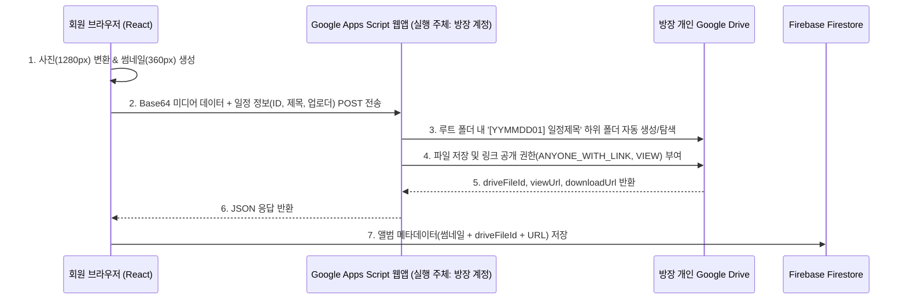

# Album and Media Compression Specification

## Overview
Healing78 커뮤니티의 일정별 추억 사진·동영상을 공유하고 모아볼 수 있는 **앨범(Album)** 기능의 미디어 일반화질 자동 변환 규격, **개인 구글 드라이브(Google Drive) 자동 저장 브릿지 아키텍처**, UI 배치 구조, 그리고 확장형 열람/업로드 권한 체계를 정의합니다.

## Business Rules & Logic

### 1. Client-Side Media Compression & Standard Quality Rules
- **사진(Image) 일반화질 자동 변환 규격:**
  - **최대 해상도:** 가로/세로 중 긴 변 기준 최대 **`1280px`** (원본 비율 유지, `1280px` 이하인 경우 리사이징 생략)
  - **압축 포맷 및 품질:** `HTML5 Canvas` 기반 `image/jpeg` (또는 `image/webp`), 품질 계수 **`0.78`**
  - **목록용 썸네일:** 그리드 렌더링 성능 및 즉시 표시(Smart Caching)를 위해 **`360 × 360px`** (품질 `0.65`) 정사각형 썸네일 프리뷰 병행 생성
  - **목표 용량:** 일반화질 본본 약 **`120KB ~ 220KB`**, 썸네일 약 **`15KB ~ 30KB`** 수준으로 원본 대비 90~95% 용량 절감
- **동영상(Video) 일반화질 규격 및 썸네일 추출:**
  - **권장 해상도 및 제한:** **`720p (1280 × 720)`** 이하 권장, 길이 최대 **`30초`**, 파일당 최대 **`15MB`** 제한
  - **자동 커버 프레임 추출:** 업로드 시 `<video>` 엘리먼트의 **`1.0초`** 지점 프레임을 캡처하여 `360px` 정지 썸네일 이미지를 자동 생성하고, 목록에서는 정지 썸네일 + `▶ 재생시간` 배지만 렌더링한 뒤 클릭 시 영상을 로드합니다.

### 2. Personal Google Drive Storage Architecture (GAS Bridge + Hybrid Caching)
카카오 로그인을 사용하는 일반 회원들이 별도의 구글 로그인 없이도 방장(운영자)의 개인 구글 드라이브에 사진·동영상을 자동 저장할 수 있도록 **Google Apps Script(GAS) 웹앱 브릿지**와 **Firestore 스마트 캐싱**을 결합한 하이브리드 구조를 사용합니다.

- **폴더 자동 분류 규칙:**
  - 지정된 구글 드라이브 루트 폴더(`ROOT_FOLDER_ID`) 아래에 일정별로 **`[26110701] 11월 서울 강남 정기 모임`** 형태의 하위 폴더가 자동 생성됩니다.
  - 저장 파일명은 **`26110701_김민준_1730700000.jpg`** 형태로 누가 언제 올린 파일인지 구글 드라이브에서도 즉시 식별할 수 있도록 명명합니다.
- **하이브리드 열람 및 폴백(Fallback) 전략:**
  - **목록 그리드:** Firestore에 캐싱된 경량 `thumbUrl`을 사용하여 구글 드라이브 트래픽 제한이나 초기 로딩 지연 없이 즉시 렌더링합니다.
  - **상세 뷰어 & 동영상 재생 & 원본 다운로드:** 구글 드라이브의 `driveFileId` 기반 스트리밍/다운로드 URL을 연결하여 재생 및 파일 저장을 지원합니다.
  - **안전 폴백:** 만약 구글 드라이브 브릿지 URL이 아직 설정되지 않았거나 일시적 네트워크 오류가 발생해도, 압축된 일반화질 이미지가 앱 내 저장소(Firestore/LocalStorage)에 안전하게 저장되어 사진 유실을 방지합니다.
  - **운영진 웹 설정 연동:** `.env`(`VITE_GOOGLE_DRIVE_BRIDGE_URL`)뿐만 아니라 앱 내 **`운영 관리 > 공지·규칙 설정`** 화면에서도 구글 드라이브 브릿지 URL을 언제든 등록·변경할 수 있도록 지원합니다.

### 3. Album Navigation & Placement Structure
- **개별 일정 `벙대기실` 내부 4번째 탭 (`📸 앨범`):**
  - 기존 3개 탭(`장소·코스`, `정산·회비`, `귀가현황`) 우측에 4번째 **`앨범`** 탭을 배치합니다.
  - 해당 일정에서 촬영한 사진·동영상을 3열 정사각형 그리드로 표시하고, 클릭 시 전체화면 라이트박스(슬라이드 뷰어)로 감상할 수 있습니다.
- **하단 메인 탭바 & PC 사이드바 `앨범` 메뉴 (`/album`):**
  - 전체 일정들의 앨범을 월별·일정별로 모아보는 전용 메뉴를 제공합니다.

### 4. Access Control & Extensible Permission Rules (Base Rule + Custom Rules)
- **기본 규칙 (Base Rule — 확정 기초안):**
  - 각 일정의 앨범 열람 및 미디어 업로드는 **해당 일정 참석자(`applicants` / `confirmedParticipants`), 주최자·총무, 그리고 운영진(`Leader`, `Deputy`)**에게 허용하는 것을 기본 원칙으로 합니다.
- **확장 규칙 슬롯 (Extensible Rule Hooks — 추가 규칙 연구·반영 예정):**
  - 기본 참석자 권한 규칙 위에 아래와 같은 커뮤니티 운영 조건을 조합(AND/OR)할 수 있도록 권한 판별 함수(`canViewMeetingAlbum(member, meeting, communityConfig)`, `canUploadMeetingMedia(member, meeting, communityConfig)`)를 분리 설계합니다:
    - *예시 확장 조건 A:* 최소 참석 횟수(`attendanceCount >= N`) 또는 특정 등급(`VIP` 이상) 전체 앨범 열람 허용 여부
    - *예시 확장 조건 B:* 업로더가 개별 사진마다 `[참석자만 공개 / 전체 회원 공개]` 범위를 선택하거나 대표 사진 1장만 전체 공개하는 옵션
    - *예시 확장 조건 C:* 앨범 업로드 시 활동/이벤트 보너스 점수 연동 여부

## Data Schema & API

### Media Item Schema (`meeting.album` array)
- `id`: string (`media-${timestamp}-${random}`)
- `meetingId`: string (`YYMMDD01`)
- `uploaderUid`: string (업로드한 회원 UID)
- `uploaderName`: string (업로드한 회원 실명)
- `mediaType`: `'image' | 'video'`
- `url`: string (일반화질 변환된 미디어 URL 또는 구글 드라이브 뷰어 URL)
- `thumbUrl`: string (`360px` 정사각형 썸네일 DataURL)
- `driveFileId`: string (개인 구글 드라이브에 저장된 파일 고유 ID, 미연동 시 빈 문자열)
- `driveDownloadUrl`: string (구글 드라이브 원본 다운로드 URL)
- `width`: number
- `height`: number
- `durationSec`: number (동영상인 경우 재생 시간, 사진은 `0`)
- `caption`: string (선택 한줄 설명)
- `visibility`: `'attendees' | 'members'` (기본값 `'attendees'`)
- `likes`: array of string (공감 회원 UID 목록)
- `createdAt`: string (`'YYYY-MM-DD HH:mm'`)

## Edge Cases & Validation
- **용량 초과 동영상 업로드 차단:** `15MB` 또는 `30초`를 초과하는 동영상 선택 시 업로드 전 즉시 안내 메시지를 표시합니다.
- **미지원 이미지 포맷 폴백:** 브라우저 Canvas 디코딩이 불가능한 포맷 선택 시 예외 처리 및 안내 토스트를 노출합니다.
- **구글 드라이브 브릿지 미설정 시 폴백:** 브릿지 URL이 비어 있는 경우 사진은 클라이언트 압축본(`1280px`)으로 즉시 앨범에 등록되어 브릿지 설정 전에도 테스트 및 사용이 가능합니다.

## Test Scenarios
1. **사진 일반화질 자동 압축 검증:** `4000×3000px` 원본 사진 업로드 시 긴 변 `1280px`, 품질 `0.78` 이하로 자동 리사이징되어 저장되는지 확인.
2. **개인 구글 드라이브 폴더 자동 분류 검증:** 일정 `#26110701`에서 사진 업로드 시 구글 드라이브 루트 폴더 하위에 `[26110701] 11월 서울 강남 정기 모임` 폴더가 생성되고 파일이 저장되는지 확인.
3. **참석자 및 운영진 권한 검증:** 미참석 회원은 해당 일정 앨범에 접근이 제한되고, 참석 신청 즉시 앨범 열람 및 업로드가 활성화되는지 확인.
