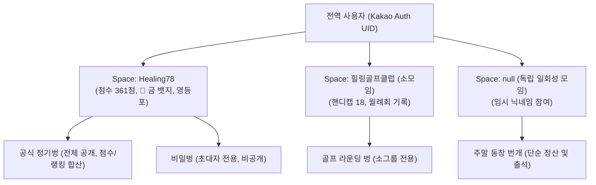

# Multi-Community, Sub-Groups & Flexible Meetings Specification (멀티 커뮤니티 및 유연한 모임 확장 명세서)

## 1. 개요 및 설계 배경 (Background & Vision)

본 문서는 Healing78 커뮤니티 단일 목적 시스템으로 출발한 Heal 플랫폼을 확장하여, **복수 커뮤니티 지원(Multi-Tenancy)**, **커뮤니티 내 소규모 크루/모임(Sub-Groups)**, **독립 일회성 번개(Standalone Meetings)**, **비밀벙(Secret Meetings)**, 그리고 **정회원 외 지인 초대(Guest/Plus-One)**까지 포괄하는 범용 모임 관리 플랫폼으로 진화시키기 위한 아키텍처 기술 명세서입니다.

기존 Healing78의 856개 모임 및 281명 회원 히스토리를 100% 온전히 보존하면서, 향후 필요 시 단계적으로 구현할 수 있는 점진적 확장 모델을 정의합니다.

---

## 2. 계층형 모듈러 아키텍처 (Hierarchical Multi-Space Model)

단일 네임스페이스(`members`, `meetings`) 구조를 **"전역 사용자(User) ➡️ 공간/커뮤니티(Space) ➡️ 소그룹(SubGroup) ➡️ 모임(Meeting)"**으로 추상화합니다.



### 핵심 엔티티 계층
1. **User (전역 사용자)**: 카카오 OAuth 인증 기반의 단일 사용자 (`kakao:51xxxx`). 전화번호, 본명, 대표 프로필 사진을 보유.
2. **Space (공간 / 커뮤니티)**: 독립된 회원 명부, 역할 체계, 뱃지/점수 규칙을 가진 최상위 그룹.
   - 기본값: `healing78`
3. **SubGroup (소그룹 / 크루)**: 커뮤니티 내의 관심사별 소모임 (골프회, 러닝크루, 지역별 소모임 등).
4. **Meeting (모임 / 벙)**: 특정 Space에 소속되거나, 소속 없이 독립(Standalone)으로 개설되는 단위 행사.

---

## 3. 5대 핵심 도메인 상세 명세

### 3.1 멀티 커뮤니티 (Multi-Tenancy) & 플러그인 룰 엔진
* **목적**: 힐링78 외에 다른 동호회, 동문회, 회사 프로젝트 등 독립된 커뮤니티를 병렬 운영.
* **설계 원칙**:
  - **전역 계정과 커뮤니티별 프로필 분리**: 사용자는 1개의 카카오 로그인으로 여러 커뮤니티에 참여하며, 각 커뮤니티마다 독립된 닉네임, 등급, 점수를 가집니다.
  - **룰 엔진 플러그인화**:
    - 힐링78 고유 규칙(78점 유니콘, 도별 원정 가산점, 규격 닉네임 생성기)을 Core에서 분리하여 `CommunityConfig`의 모듈형 옵션으로 전환.
    - 새로운 커뮤니티 생성 시 `scoreSystemEnabled: false`(단순 출석형) 또는 `customBadgeTiers: [...]`(자체 뱃지 체계)를 선택 가능.

### 3.2 소규모 모임 / 크루 (Sub-Groups & Circles)
* **목적**: 커뮤니티 내부의 취미·지역 소모임 관리.
* **설계 원칙**:
  - `Space` 하위에 `SubGroup` 메타데이터 관리.
  - 소모임 벙 개설 시 `creditToParentSpace` 플래그 제공:
    - `true`: 소모임 참석 기록과 함께 커뮤니티 본진 벙점수/출석에도 공식 합산.
    - `false`: 소모임 자체 기록으로만 유지.

### 3.3 일회성 / 독립 모임 (Standalone / Pop-up Meetings)
* **목적**: 커뮤니티 가입 절차 없이 링크 하나로 친구들끼리 모여 1차/2차 회비 정산과 참석 관리를 진행하는 가벼운 모임.
* **설계 원칙**:
  - `spaceId: null` (소속 커뮤니티 없음).
  - **Zero-Friction 온보딩**: 회원가입(지역, 결혼, 성별)을 요구하지 않고, 카카오 간편인증 1초 또는 임시 닉네임 입력만으로 모임방 즉시 입장.
  - 벙점수, 뱃지, 랭킹 기능은 숨겨지고 **실시간 대기실, 차수별 영수증 정산(N분의 1), 안심귀가 기능만 집중 제공**.

### 3.4 비밀벙 (Private / Secret Meetings)
* **목적**: 특정 멤버들끼리만 모이며, 전체 모임 목록에는 노출되지 않는 프라이빗 모임.
* **설계 원칙**:
  1. **가시성 제어 (`visibility: 'SECRET'`)**:
     - 전체 모임 목록(`meetings`) 쿼리 시 비밀벙은 기본 배제.
     - 오직 허용된 사용자 목록(`allowedUids`)에 포함되거나, 고유 초대 토큰(`?inviteToken=xxx`)을 가진 사용자에게만 화면 노출.
  2. **점수 합산 정책 분기**:
     - **친목 비공식 모드**: 마감 시 커뮤니티 벙점수 미부여 (완전한 비공개).
     - **공식 인정 비밀벙 모드**: 마감 시 점수는 정상 합산되되, 타인에게는 모임 제목이 "비공개 모임"으로 마스킹되어 점수 로그만 표출.

### 3.5 지인 / 게스트 동반 (Guest / Plus-One Attendance)
* **목적**: 정회원이 지인을 동반(+1)하거나 비회원이 일시적으로 모임에 합류할 때 회비 정산 오류 방지.
* **설계 원칙**:
  1. **참여자(Participant) 모델 추상화**:
     - `confirmedParticipants` 문자열 배열 구조를 확장하여 정회원과 게스트를 모두 포괄.
  2. **정산(Finance)과 점수(Score)의 완전 분리**:
     - **정산(1/N 회비 배분)**: 게스트도 1인으로 정밀 산정되어 차수별 영수증 정산 및 입금 상태 확인에 정상 참여.
     - **벙점수/뱃지**: 정회원에게만 벙점수 스냅샷이 부여되며, 게스트는 정산 명단에만 참여.
     - 추후 해당 지인이 커뮤니티에 정식 가입할 경우, 초대한 회원의 기록을 기반으로 과거 참석 이력을 새 계정에 원클릭 승계 가능.

---

## 4. 데이터베이스 (Firestore) 스키마 확장안

기존 Healing78 데이터를 훼손하지 않는 하위 호환형 스키마 설계입니다.

```
firestore/
├── spaces/ {spaceId}                      # 커뮤니티/공간 메타데이터
│   ├── name: "Healing78"
│   ├── slug: "healing78"
│   ├── config: { ...ruleEngineConfig }   # 뱃지, 권역 가산점, 닉네임 규칙
│   └── members/ {uid}                     # 해당 커뮤니티 내 회원 프로필
│       ├── realName, city, role, totalScore, baseScore, expeditionScore
│       └── subUids: [...]                 # 서브폰 및 과거 가상코드
│
├── meetings/ {meetingId}                  # 모임 공통 컬렉션
│   ├── spaceId: "healing78"              # null이면 Standalone(독립 모임)
│   ├── subGroupId: "golf_club"           # 소모임 ID (선택)
│   ├── visibility: "PUBLIC"              # PUBLIC | SECRET | UNLISTED
│   ├── inviteToken: "sec_8f9a2b"         # 비밀벙 초대 토큰
│   ├── allowedUids: ["kakao:1002", ...]  # 비밀벙 열람 허용 UID
│   ├── hostUid: "kakao:5173773611"
│   ├── treasurerUid: "kakao:5173773611"
│   ├── confirmedParticipants: [...]      # 정회원 UID 목록 (기존 호환)
│   ├── guests: [                         # [신설] 동반 지인 / 게스트 목록
│   │   {
│   │     guestId: "gst_01",
│   │     name: "민수 (봄날 지인)",
│   │     inviterUid: "kakao:1002",
│   │     paymentStatus: "confirmed"
│   │   }
│   │ ]
│   ├── rounds: [                         # 차수별 정산 (정회원 + 게스트 포함 N빵)
│   │   {
│   │     roundNo: 1,
│   │     cost: 150000,
│   │     participants: ["kakao:1002", "gst_01", ...]
│   │   }
│   │ ]
│   └── memberScoreSnapshots: { ... }     # 정회원 전용 당시 뱃지/점수 스냅샷
│
└── users/ {uid}                          # 전역 사용자 (카카오 인증 계정 기본 정보)
    ├── realName: "홍길동"
    ├── phone: "010-1234-5678"
    └── joinedSpaces: ["healing78", "running_crew"] # 가입 공간 목록
```

---

## 5. 단계별 점진적 도입 로드맵 (Phased Roadmap)

기존 운영 환경의 안정성을 유지하면서 필요한 시점에 순차 개발할 수 있는 추천 순서입니다.

```
[Phase 1: 단일 커뮤니티 내 경량 확장 (가장 우선 구현 가능)]
  - 모임 내 '지인 동반(+1)' 등록 및 차수별 N빵 정산 참여 기능 추가
  - 모임 개설 시 '비밀벙(초대 링크 전용)' 옵션 추가

[Phase 2: 일회성 독립 모임 분리 (Standalone Mode)]
  - 커뮤니티 가입 없는 독립 벙 링크(?mode=standalone) 생성 지원
  - 정산, 영수증, 안심귀가에 특화된 경량 모임 뷰 제공

[Phase 3: 멀티 커뮤니티(Space) 플랫폼 확장]
  - 상단 Space 스위처(공간 전환 드롭다운) UI 구축
  - 커뮤니티 생성기 및 커뮤니티별 룰셋(점수제 ON/OFF, 닉네임 규격) 설정 지원
```

---

## 6. 하위 호환성 보장 전략 (Backward Compatibility)

1. **기존 데이터 보존**:
   - `spaceId`가 없는 기존 856개 모임 및 281명 회원은 시스템 초기 로드 시 자동으로 `spaceId: 'healing78'`로 간주하여 처리됩니다.
2. **무중단 운영**:
   - 게스트 필드(`guests: []`)와 비밀 플래그(`visibility: 'PUBLIC'`)가 누락된 과거 모임은 기존 로직대로 100% 정상 작동합니다.
